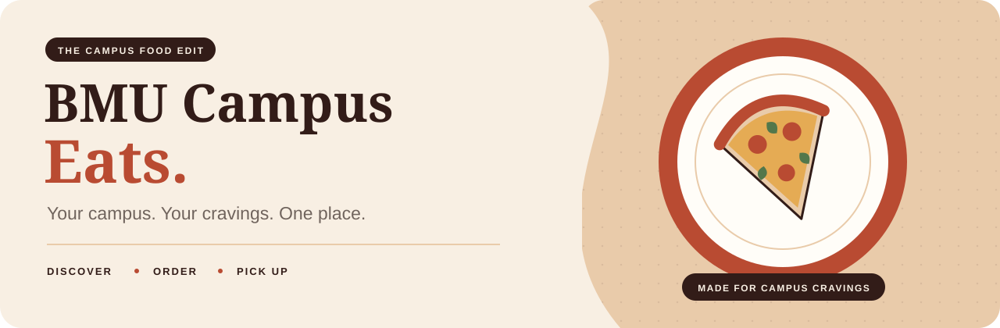

<p align="center">
  
</p>

<div align="center">

# BMU Campus Eats

**Your campus. Your cravings. One place.**

A campus food-ordering project bringing menus, student accounts, checkout and order management into one warm, food-inspired experience.


[Explore the design](https://www.figma.com/design/pOPskhvCKVF6aPYKMedHs5/BMU-CAMPUS-EATS?node-id=3-1141) · [Run locally](#run-locally) · [Project structure](#project-structure) · [Team](#five-members-one-project)

</div>

---

## From craving to pickup

**Discover a shop → choose your food → review your cart → place a demo order → track its status.**

| Experience | What the project supports |
| :--- | :--- |
| **Discover** | Linked shops and menus, searching, filtering, item options and stock-aware ordering. |
| **Make it yours** | BMU email signup, login, a separate editable profile, favourites and saved addresses. |
| **Order confidently** | Cart quantities, checkout, server-checked prices and coupons, and duplicate-order retry protection. |
| **Stay informed** | Saved order history and tracking that reflects administrator status updates. |
| **Manage the menu** | Admin tools for menu items, stock, restaurant availability, offers and order status. |
| **Enjoy the details** | Cream and terracotta styling, water-surface interaction and cart motion. |

> **Project demo:** orders use payment at pickup. The app does not process online payments or send orders to restaurant systems. MongoDB integration is pending.

## Project structure

Browse in order: **design → frontend → backend → data → documentation**.

```text
bmu-campus-eats/
├── 01-designs/              # Complete design-code export and Figma reference
│   ├── html/                # All page layouts, separated from CSS
│   ├── css/                 # Page-specific and shared design styles
│   ├── scripts/             # Scripts needed to render the designs
│   └── assets/              # Design images and SVGs
├── 02-frontend/
│   ├── pages/               # Separate HTML files for each screen
│   ├── styles/              # Page-specific and shared CSS
│   ├── scripts/             # Browser interactions and API calls
│   └── assets/              # SVG and PNG assets
├── 03-backend/
│   ├── server.js            # Express, accounts, sessions and page serving
│   └── commerce.js          # Checkout, orders and admin APIs
├── 04-data/
│   └── menu-data.json       # Starting menu catalog
├── 05-documentation/
│   ├── team-roles.md        # Ownership and contribution workflow
│   └── architecture.md      # Request flow, API map and storage
├── .gitignore
├── package.json
├── package-lock.json
└── README.md
```

| Start here | Purpose |
| :--- | :--- |
| [01 · Designs](01-designs/README.md) | All 14 pages' HTML and CSS, scripts, assets, preview instructions and Figma reference. |
| [02 · Frontend](02-frontend) | Page markup, styles, scripts and visual assets. |
| [03 · Backend](03-backend) | Express application and business rules. |
| [04 · Data](04-data/README.md) | Menu seed and runtime storage explanation. |
| [05 · Documentation](05-documentation) | Team responsibilities and technical walkthrough. |

Public URLs stay the same: `/`, `/shops.html`, `/menu.html`, `/cart.html`, and so on.

The exported design code can be previewed at `/designs/` while the server is running. `npm run sync:designs` refreshes it from the working frontend; `npm start` runs this sync automatically. See the [page-by-page HTML and CSS index](01-designs/README.md#page-by-page-design-code).

## Run locally

Install **Node.js 22 or newer** with npm, then run:

```bash
git clone https://github.com/Tapesh001/BMU_Campus-Eats.git
cd BMU_Campus-Eats
npm ci
npm start
```

Open **[http://localhost:8765](http://localhost:8765)** and keep the terminal running. For an existing copy, run the npm commands from the folder containing `package.json`.

### Optional configuration

Create a private `.env` beside `package.json`:

```dotenv
PORT=8765
HOST=0.0.0.0
BMU_ADMIN_PASSWORD=replace-with-your-own-long-unique-password
```

`BMU_DATA_DIR` optionally sets an absolute directory for saved data. The default is `.bmu-campus-eats` in your operating-system home folder. `.env` is ignored by Git; never commit real credentials.

### Try the main flows

1. Open `/register.html` and register using an `@bmu.edu.in` address. The current check validates the domain; it does not verify mailbox ownership.
2. Browse `/shops.html`, select a menu item and add it to your cart.
3. Review `/cart.html`, continue to checkout and place a demo pickup order.
4. Open `/orders.html` and view the order's tracking screen.
5. Set the admin password above, open `/admin.html` and update the order status to see it reflected in tracking.

### Open on another phone or laptop

Connect both devices to the same network. Find the server computer's local IPv4 address (`ipconfig` on Windows), then open `http://YOUR-PC-IP:8765` on the other device. Keep Node running and allow the connection through the firewall on your trusted network.

`localhost` refers to the device opening the page. Access outside your network requires hosting or an HTTPS tunnel. A temporary tunnel works only while the computer, server and tunnel process remain running.

## Five members, one project

These are **proposed responsibilities**, not claims about who authored existing commits. Replace placeholders with names and GitHub usernames when assigned.

| Member | Main responsibility | Starting files |
| :--- | :--- | :--- |
| **Tapesh · Team lead** | Backend, authentication, persistence, admin, integration and release review | [Backend](03-backend), [admin page](02-frontend/pages/admin.html), [admin script](02-frontend/scripts/admin.js) |
| **Member 2 · Design & experience** | Figma, home, shared styling, motion, assets and help | [Designs](01-designs), [home](02-frontend/pages/index.html), [shared styles](02-frontend/styles/site.css), [water effect](02-frontend/scripts/water-surface.js) |
| **Member 3 · Student accounts** | Signup, login, profile and favourites | [Register](02-frontend/pages/register.html), [profile](02-frontend/pages/profile.html), [account logic](02-frontend/scripts/account.js) |
| **Member 4 · Shops & menus** | Shop discovery, catalog, options, stock display and offers | [Shops](02-frontend/pages/shops.html), [menu](02-frontend/pages/menu.html), [catalog](04-data/menu-data.json) |
| **Member 5 · Ordering** | Cart, checkout, order history and tracking | [Cart](02-frontend/pages/cart.html), [checkout logic](02-frontend/scripts/checkout.js), [tracking logic](02-frontend/scripts/tracking.js) |

**Lead's key responsibility:** connect the modules into a working application and own server validation, authentication, persistence and integration testing. Each frontend owner maintains the matching page CSS and coordinates shared scripts with the lead.

Read the [complete ownership and Git workflow](05-documentation/team-roles.md). Use **collaborators + individual feature branches + pull requests** so real contributions remain visible and reviewable.

## Under the hood

| Layer | Implementation |
| :--- | :--- |
| Interface | Separate HTML/CSS files, vanilla JavaScript and browser fetch calls. |
| Server | Node.js + Express 5 serving both pages and `/api` routes. |
| Accounts | BMU-domain validation, salted password hashes and expiring HTTP-only session cookies. |
| Catalog | Repository seed JSON with private administrator-edited overrides. |
| Submissions | Profiles, orders, favourites, addresses and offers saved to local JSON. |

See the [architecture and API guide](05-documentation/architecture.md) for request flow and storage details.

## Evaluation readiness

| Requirement | Current implementation |
| :--- | :--- |
| Additional linked pages | Implemented across accounts, discovery, ordering and administration. |
| JavaScript validation and UX interactions | Implemented in forms, menus, cart and checkout. |
| Form submission and local JSON persistence | Implemented through Express APIs. |
| Node + Express setup and API creation | Implemented. |
| External API integration | Not currently required for menus; browser requests use this project's own API. |
| CRUD using MongoDB | **Pending.** Current CRUD uses local JSON. |

Online payment, verified restaurant fulfilment and permanent public hosting are not implemented. Restaurant details and unclear menu prices need confirmation before being presented as verified information. Sessions end on server restart; JSON storage is intended for this project demonstration.

---

<div align="center">

**Built around campus life. Designed around food.**

[Design reference](https://www.figma.com/design/pOPskhvCKVF6aPYKMedHs5/BMU-CAMPUS-EATS?node-id=3-1141) · [Source code](https://github.com/Tapesh001/BMU_Campus-Eats) · [Team guide](05-documentation/team-roles.md)

</div>
